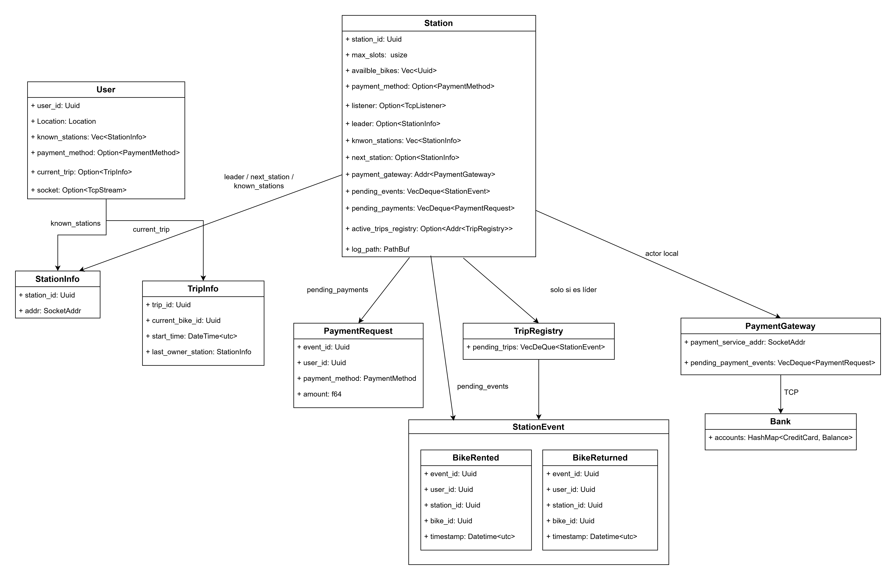
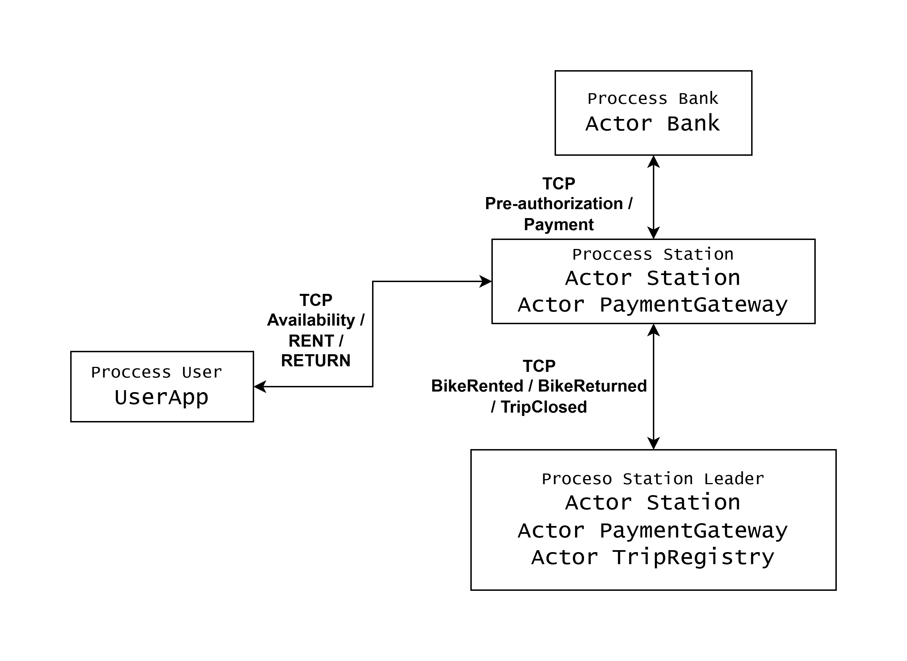

# Pre-Entrega Trabajo Práctico Bicicletas 

## Integrantes
- Rivero Trujillo, Tobias - 106302
- Paz Blanco, Pilar - 105600
- Chen, Michelle Melisa - 105506


## Diseño y Estructuras

A continuación se describen los principales mecanismos que serán utilizados en el diseño del sistema:  

| Mecanismo | Uso | Justificación |
| :---: | :---: | :--- |
| Modelo de Actores | `Station`, `User`, `PaymentGateway`, `TripRegistry` | Se utiliza para encapsular estado interno mutable y procesar mensajes de forma secuencial. Así, se evitan accesos concurrentes directos sobre estructuras compartidas |
| TCP con tokio | Comunicación asíncrona entre procesos independientes | Se utiliza para la comunicación entre aplicaciones ejecutadas en procesos distintos:  Conexión de `User` con `Station`, conexión de `Station` con `PaymentGateway`, conexión de `Station` con la siguiente `Station` en el anillo y con la estación `leader`. Tokio permite manejar conexiones TCP, tareas, timeouts y reintentos de manera asíncrona |
| Algoritmo de Anillo | Elección de líder | Las estaciones se organizan en un anillo lógico. Cada estación conoce la siguiente estación del anillo. El líder mantiene `TripRegistry` que registra los viajes activos y cerrados a partir de los eventos de sincronización enviados por las estaciones |
| Registro de Estados Globales | Prevención de un único punto de fallo | Cada estación mantiene una cola local de `pending_events` con los eventos que generó y que todavía no fueron confirmados por el líder, por ejemplo inicios o cierres de viaje. La estación envía estos eventos al líder, pero no los elimina de su cola hasta recibir un `ACK`. El líder mantiene el `TripRegistry`, que registra los viajes activos y cerrados de todas las estaciones a partir de esos eventos. Cuando una bicicleta es devuelta en cualquier estación, dicha estación genera un evento de cierre de viaje y lo envía al líder. Una vez que el líder actualiza el `TripRegistry` y confirma el evento, la estación que envió el cierre puede eliminarlo de sus `pending_events` |
| Coordinación de Pagos y Sincronización Eventual | Alquiler de bicicleta | Se utiliza para coordinar la reserva local de una bicicleta, la pre-autorización y el registro del viaje local y en el líder. Si falla la pre-autorización, se aborta la operación de alquiler y la bicleta no se desbloquea al usuario |
| Timeouts y reintentos | Pre-autorización y comunicación con servicio externo | Si una pre-autorización falla o expira durante un alquiler, la bicicleta no se entrega. Si falla un cobro durante una devolución, la bicicleta se acepta igualmente y el cobro se encola en `pending_payments` para reintarlo más tarde hasta lograrlo |
| Log | Recuperación ante caídas | Cada estación mantiene un log local con los eventos relevantes, como inicio, cierre de viajes y el estado de la estación. Si una estación se cae, puede reconstruir su estado local desde log |

## Panorama del Sistema



## Estación


Cada estación se modela como un proceso independiente que ejecuta un Actor `Station`.

La aplicación usuario se conecta directamente a una estación cercana para consultar disponibilidad, alquilar y devolver una bicicleta. Esta conexión usuario-estación se modela mediante TCP. 

La estación posee: 
- `station_id`: Un identificador de la estación.
- `max_slots`: Capacidad total de la estación. 
- `available_bikes`: Una lista de identificadores de bicicletas actualmente disponibles en la estación. 
- `listener`: Un TcpListener para escucha de conexiones de entrantes que podría ser un usuario u otra estación. 

No se modela cada slot individualmente, alcanza con conocer la capacidad máxima de la estación y la lista de bicicletas disponibles. La cantidad de lugares libres se calcula como:

`free_slots = max_slots - available_bikes.len()`

Cuando un usuario alquila una bicicleta, la estación remueve el `bike_id` elegido. Cuando un usuario devuelve una bicicleta, la estación verifica que haya lugar libre y luego agrega el `bike_id` a `available_bikes`. 

La estación mantiene dos colas colas: 
- `pending_events`: Eventos generados localmente que todavía no fueron confirmados por el líder. Por ejemplo, eventos de inicio o cierre de viaje pendientes de sincronización. 

- `pending_payments`: Cobros que no pudieron procesarse y deben reintentar más tarde. 

### Algoritmo de Anillo 

Elegimos el algoritmo del anillo para minimizar la cantidad de mensajes enviados. 

Las estaciones se organizan en un anillo lógico. Cada estación conoce a la siguiente estación del anillo y mantiene una lista de estaciones conocidas para poder recomponer el anillo ante caídas.

El anillo se utiliza principalmente para la elección de un nuevo líder cuando el líder actual deja de responder. La caída del líder se detecta mediante timeout al intentar comunicarse con él.

El campo `leader` almacena la información de la estación que actualmente cumple el rol de líder.

La estación líder es la única que ejecuta localmente el actor `TripRegistry`. Este Actor mantiene el estado global de los viajes activos y cerrados. El actual líder recibe los eventos de sincronización de las demás estaciones y se las comunica al `TripRegistry`. Específicamente, el Actor `TripRegistry` se corre localmente dentro de cada proceso estación, pero si la estación no es líder, se comunica con el líder mediante TCP guardado en `leader` para registrar nuevos viajes o viajes cerrados. 

Cuando una estación genera un evento que debe ser registrado globalmente, lo agrega primero a pending_events y lo envía al líder. La estación no elimina ese evento de pending_events hasta recibir un `ACK`. Si no recibe confirmación, conserva el evento y lo reintenta más tarde. 

Si el líder cae, las estaciones inician una elección mediante el algoritmo de anillo. Una vez elegido el nuevo líder, cada estación actualiza su campo `leader` y reenvía los eventos pendientes de su cola `pending_events`. De esta manera, el nuevo líder puede reconstruir el estado del `TripRegistry`.

Si se agrega una nueva estación, se dispara elección de líder nuevo. 

Además, cada estación mantiene un log local que registra todos los eventos de la propia estación que sirve para la reconstrucción del último estado de la estación en caso de que la estación caiga. 

~~~

Struct Station {
    station_id: Uuid
    max_slots: usize,
    available_bikes: Vec<Uuid>,  
    listener: Option<TcpListener>, // TcpListener de tokio,

    leader: StationInfo,
    known_stations: Vec<StationInfo>, 
    next_station: Option<StationInfo>, 

    payment_gateway: Addr<PaymentGateway>,

    // pending_events solamente quita un evento de prestar bicicletas 
    // fue notificada a través del líder sobre la devolución 

    pending_events: VecDeque<StationEvent>,
    pending_payments: VecDeque<PaymentRequest>,

    // El campo active_trips_registry solo es Some (...) si la estación actual es el líder. 
    // Para estaciones no líderes, este campo es None, 
    // ya que se comunican con el TripRegistry enviado mensajes al líder mediante TCP

    active_trips_registry: Option<Addr<TripRegistry>>
    log_path: PathBuf, 
}

enum StationEvent {
    BikeRented {
        event_id: Uuid, 
        user_id: Uuid, 
        station_id: Uuid, 
        bike_id: Uuid, 
        timestamp: DateTime<Utc>
    }

    BikeReturned {
        event_id: Uuid, 
        user_id: Uuid, 
        station_id: Uuid, 
        bike_id: Uuid, 
        timestamp: DateTime<Utc>
    }

}

struct StationInfo {
    station_id: Uuid,
    // Ubicación geográfica en coordenadas (provisional) 
    // location: Location, 
    addr: SocketAddr, 
    socket: Option<TcpStream>
}

struct PaymentGateway {
    payment_service_addr: SocketAddr, 
    peding_payment_events: VecDeque<PaymentRequest>, 
}

struct Bank {
    accounts: HashMap<CreditCard, Balance>, 
}
~~~

### Sincronización de Viajes Activos y Eventos Pendientes

Cada estación mantiene una cola `pending_events` con los eventos locales que generó y que todavía no fueron confirmados por el líder. Estos eventos pueden representar, por ejemplo, el inicio de un viaje (`BikeRented`) o el cierre de un viaje (`BikeReturned`).

Cuando una estación presta una bicicleta, genera un evento `BikeRented` y lo envía al líder. Si el líder registra correctamente el evento en el `TripRegistry`, responde con `ACK`. 

Una vez confirmado el evento `BikeRented`, el viaje queda abierto en el `TripRegistry` del líder. La estación de origen mantiene ese evento como pendiente hasta que la bicicleta sea devuelta. 

Cuando el usuario devuelve la bicicleta en cualquier estación, la estación de devolución genera un evento `BikeReturned`. Esta estación acepta la bicicleta localmente si tiene lugar disponible, registra el evento en su log local y lo agrega a `pending_events`. Luego intenta enviarlo al líder.

Si el líder recibe el evento `BikeReturned`, cierra el viaje activo en el `TripRegistry`, registra la estación de devolución y responde `ACK` a la estación que informó la devolución. El líder, además, envía un mensaje de `ClosedTrip` a la estación que había alquilado la bicicleta para informar sobre la devolución. 

Si la estación que recibe la devolución no puede comunicarse con el líder, mantiene el evento `BikeReturned` en `pending_events` y lo reintenta más tarde. La devolución física de la bicicleta queda aceptada localmente, pero la sincronización global del viaje queda pendiente hasta recuperar conexión con el líder o hasta que se elija un nuevo líder.

Si el líder cae, las estaciones detectan la falla por timeout e inician una elección mediante el algoritmo de anillo. Una vez elegido el nuevo líder, cada estación reenvía los eventos que todavía tenga en `pending_events`, permitiendo reconstruir el estado del `TripRegistry`.

### Coordinación con Pagos y Sincronización Eventual: Pre-autorización y Pago

El servicio de pago se modela como un proceso independiente. Dentro de cada estación existe un actor local `PaymentGateway`, encargado de encapsular la comunicación con el servicio de pagos externos. El Actor `Station` no se comunica directamente con el banco, sino que envía solicitudes de pre-autorización y cobro al Actor `PaymentGateway`. Este úlitmo se encargará abrir la conexión con el servicio externo de pagos, enviar las solictudes, esperar la respuesta, devolver la respuesta a la estacíon y reintentar en caso de timeout. 

La estación mantiene autoridad sobre su estado físico local y prioriza que el alquiler y la devolución puedan resolverse localmente, incluso si temporalmente no hay conexión con el líder.

Para el caso de **RENT**: 
1. La estación manda las disponibilidad al usuario. 
2. El usuario elige el ID de la bicicleta que desea alquilar. 
3. La estación reserva temporalmente la bicicleta pedida. 
4. La estación solicita al `PaymentGateway` la pre-autorización del monto de seguridad. 
5. Si la pre-autorizaición falla o expira por tiemout, la estación cancela la reserva y no libera la bicicleta. 
6. Si la pre-autorización es exitosa, la estación libera la bicicleta al usuario. 
7. La estación registra localmente el evento `BikeRented` en su log y encola el evento en `pending_events`. 
8. La estación intenta informar el inicio de viaje al líder para que este actualice el `TripRegistry`. 
9. El líder responde con `ACK`.
10. Si el líder no responde, la estación dispara elección del líder: 
    - Si no responde el resto de las estaciones, significa que la estación está desconectada del resto. Se proclama líder e reintenta hasta obtener respuesta de alguna del resto de las estaciones. 
    - Si alguna de las estaciones responde al mensaje de elección, significa que el líder está caído, se elije un nuevo líder y todas las estaciones envían sus eventos pendientes para reconstruir el `TripRegistry`.

Para el caso de **RETURN**:
1. La estación manda las disponibilidad al usuario. 
2. El usuario manda solicitud de devolución junto con el ID de la bicicleta a devolver. 
3. Si no hay lugar en la estación, se rechaza la devolución. 
4. Si hay lugar, acepta la bicicleta localmente. 
5. La estación registra localmente el evento de `BikeReturned` en su log y encola el evento en `pending_events`.  
7. La estación intenta informar el cierre de viaje al líder para que este actualice el `TripRegistry`. 
8. La estación calcula el monto a cobrar usando el timestamp actual, el timestamp de inicio de viaje mandado por el usuario y el precio por minuto (en caso de que se pierda el timestamp de comienzo en la apliación usuario, la estación obtiene la información desde el líder).
9. La estación se comunica con `PaymentGateway` para cobrar el monto calculado. 
10. Si el cobro falla por timeout o error de conexión, la devolución se mantiene aceptada y el cobro se encola en `pending_payments`. 
11. `PaymentGateway` reintentará hasta lograr el cobro. La estación recibirá la confirmación de `PaymentGateway` cuando éste logre resolver los pagos pendientes.
12. La estación informa al líder sobre la devolución de la bicicleta. 
13. El líder al recibir el aviso de devolución responde `ACK`. 
14. El líder cierra el viaje activo de la bicleta devuelta. Si la estación de alquiler es distinta de la estación de devolución, el líder notifica a la estación de alquiler la devolución de la respectiva bicicleta para que cierre el viaje activo pendiente.   
15. La estación de alquiler de la bicicleta devuelta, una vez que reciba la notificación del líder desencola de `pending_events` el evento de `BikeRented` de la bicicleta devuelta. 



### Consulta de Ubicación de una Bicicleta

El líder mantiene el estado global de los viajes activos y cerrados mediante el `TripRegistry`, pero no necesariamente mantiene en todo momento una copia completa del estado físico de cada estación.

Para consultar en qué estación se encuentra una bicicleta, se utiliza el anillo de estaciones. La estación que recibe la consulta envía un mensaje `FindBike(bike_id)` a la siguiente estación del anillo. Cada estación verifica localmente si la bicicleta se encuentra en su lista `available_bikes`. Si la encuentra, responde con su `station_id`. Si no la encuentra, reenvía la consulta a la siguiente estación.

Este enfoque evita que cada cambio local de bicicletas tenga que ser comunicado inmediatamente a todas las estaciones o al líder. En lugar de mantener una copia global completa y constantemente actualizada, se consulta la ubicación de una bicicleta bajo demanda.

Si una estación está caída o desconectada, no podrá responder si la bicicleta se encuentra allí. En ese caso, la consulta puede quedar incompleta o responder que la ubicación no pudo determinarse temporalmente. 

### Persistencia

Cada estación mantiene un log local en `log_path`. Antes de confirmar una operación relevante, escribe el evento en el Log. Esto permite recuperar el estado local de una caída y reenviar al líder los eventos que hayan quedado pendientes a sincronizar. 

El líder también mantiene un log global de los viajes activos. Si cae y se elige un nuevo líder, las estaciones reenvían los eventos eventos pendientes para reconstruir `TripRegistry`. 

``` 
enum StationEvent {
    BikeRented {
        event_id: Uuid, 
        user_id: Uuid, 
        station_id: Uuid, 
        bike_id: Uuid, 
        timestamp: DateTime<Utc>
    }

    BikeReturned {
        event_id: Uuid, 
        user_id: Uuid, 
        station_id: Uuid, 
        bike_id: Uuid, 
        timestamp: DateTime<Utc>
    }
}
```

## Usuario
La aplicación Usuario se modela como un proceso independiente encargado de iniciar las operaciones de **RENT** (alquiler de bicicleta) o **RETURN** (devolución de bicicleta) de bicicletas. Cada usuario posee:

- `user_id`: Un identificador único 
- `location`: Una ubicación actual 
- `known_stations`: Una lista de todas las estaciones disponibles 
- `payment_method`: Un método de pago 
- `TripInfo`: La información del viaje actual, si el usuario pidió prestado de bicicleta
- `socket`: Un socket TCP para la comunicación con la estación  

``` 
struct User {
    user_id: Uuid,
    location: Location, 
    known_stations: Vec<StationInfo>, 
    payment_method: Option<PaymentMethod>
    current_trip: Option<TripInfo>
    socket: Option<TcpStream> // de tokio
}

struct Location {
    coords: (usize, usize)
}

enum PaymentMethod {
    CreditCard(String)
}

// La lista de estaciones contiene, para cada estación, 
// su ubicación en coordenadas y la dirección de la red necesaria par conectarse a ella
struct StationInfo {
    coords: (usize, usize)
    addr: SocketAddr
}

struct TripInfo {
    trip_id: Uuid, 
    current_bike_id: Uuid, 
    start_time: DateTime<Utc>, 
    last_owner_station: StationInfo
}
```
El campo known_stations contiene la información necesaria para que el usuario pueda elegir una estación y conectarse a ella. Para elegir una estación, la aplicación calcula la distancia euclideana entre su ubicación actual y la ubicación de cada estación conocida.

Una vez elegida la estación, el usuario abre una conexión mediante TcpStream usando el SocketAddr almacenado en `StationInfo`. A través de esa conexión recibe el mensaje de información de disponibilidad de parte de la estación y envía el mensaje correspondiente:

- **RENT**: Si quiere alquilar una bicicleta. 

Ejemplo de mensaje: 
    RENT|user_id|bike_id|credit_card

- **RETURN**: Si quiere devolver una bicicleta. 

Ejemplo de mensaje:
    RETURN|user_id|bike_id|start_time|last_owner_station_id|credit_card|

El usuario mantiene un campo `current_trip` que contendrá la información del viaje activo con `TripInfo` que posee: 
- `trip_id`: Identificador el viaje activo
- `current_bike`: Identificador de la bicicleta 
- `start_time`: Timestamp del inicio del viaje
- `last_owner_station`: Información de la estación de donde el usuario pidió prestado de la bicicleta. 

Para evitar que la información del viaje activo dependa solamente de la aplicación usuario, esta información del viaje activo también la registrará el líder de las estaciones como se ha explicitado anteriormente. 

## Mensajes

Nuestro sistema está compuesto por procesos independientes: 
- Aplicación Usuario 
- Estaciones
- Medio de Pago - PaymentGateway

Las comunicaciones entre procesos se realizan mediante TCP. Dentro de cada proceso, los componentes modelados como actores se comunican a través de mensajes internos y los mensajes son procesados de manera secuencial. 

### Alquiler de Bicicleta

El usuario calcula la distancia a la estación y se conecta a la estación más cercana a través de una conexión TCP. Si la conexión fue exitosa obtiene un TcpStream para la comunicación.  

| Emisor | Receptor | Mensaje | Comportamiento |
| :---: | :---: | :---: | :--- |
| Station | User | Availability { station_id: Uuid, bikes_available: Vec<Uuid>, free_slots: usize } | Una vez que el usuario se conecta a la estación más cercana, la estación le envía las bicletas y los slots libres que tiene disponibles |
| User | Station | RentBike { user_id: Uuid, bike_id: Uuid, payment_method: CreditCard } | El usuario elige la bicicleta `bike_id` que desea alquilar y envía una solicitud con el identificador junto con el medio de pago y su propio identificador a la estación |
| Station | Station | ReserveBike { user_id: Uuid, bike_id: Uuid } | La estación reserva momentáneamente la bicicleta elegida por el usuario |
| Station | PaymentGateway | PreAuthorizationRequest { user_id: Uuid, payment_method: CreditCard} | La estación pide a `PaymentGateway` el monto de pre-autorización y espera la confirmación |
| PaymentGateway | Bank | PreAuthorizationRequest { event_id: Uuid, payment_method: CreditCard } | El Actor `PaymentGateway` se conecta a través de un Socket TCP a `Bank` y manda a la entidad bancaria la pre-autorización |
| Bank | PaymentGateway | PreAuthorizationOK { event_id: payment_method: CreditCard } | `Bank` confirma la pre-autorización a `PaymentGateway`|
| PaymentGateway | Station | PreAuthorizationOK { event_id: payment_method: CreditCard } | La estción recibe la confirmación de pre-autorización y prepara el registro de `BikeRented { event_id: Uuid, user_id: Uuid, station_id: Uuid, bike_id: Uuid, timestamp: DateTime<Utc> }` a `TripRegistry` |
| Station | User | RentBikeOK { trip_id: Uuid, station_id: Uuid, bike_id: Uuid, timestamp: DateTime<Utc> } | La estción confirma el alquiler de bicicleta al usuario |
| Station | Log Local | BIKE_RENTED { event_id: Uuid, user_id: Uuid, bike_id: Uuid } | La estación registra en su log local el alquiler de la bicicleta |
| Station | Station Líder | BikeRented { event_id: Uuid, user_id: Uuid, station_id: Uuid, bike_id: Uuid, timestamp: DateTime<Utc> } | La estción notifica a la estación sobre el evento nuevo evento de alquiler `BikeRented { event_id: Uuid, user_id: Uuid, station_id: Uuid, bike_id: Uuid, timestamp: DateTime<Utc> }` a `TripRegistry` y al mismo tiempo encola este evento en `pending_events` |
| Station Líder | Station | BikeRentedACK { event_id: Uuid, user_id: Uuid, station_id: Uuid, bike_id: Uuid } | La estción recibe el ACK de la estación líder |

### Devolución de Bicicleta
| Emisor | Receptor | Mensaje | Comportamiento |
| :---: | :---: | :---: | :--- |
| Station | User | Availability { station_id: Uuid, bikes_available: Vec<Uuid>, free_slots: usize } | Una vez que el usuario se conecta a la estación más cercana, la estación le envía las bicletas y los slots libres que tiene disponibles |
| User | Station | ReturnBike { user_id: Uuid, payment_method: CreditCard, trip_info: TripInfo} | El usuario solicita devolver la bicicleta `bike_id`, `timestamp` de inicio de viaje y `last_owner_station` contenidas en `TripInfo`. También envía el medio de pago |
| Station | User | ReturnBikeRejected | Si no hay lugar disponible, la estación rechaza la devolución y el usuario debe intentar devolver la bicicleta en otra estación |
| Station | User | ReturnBikeOK | Si hay lugar, la estación acepta la bicicleta y confirma la devolución al usuario |
| Station | Log local | BIKE_RETURNED {event_id: Uuid, trip_id: Uuid, user_id: Uuid, last_owner_station_id: Uuid, start_trip_timestamp: DateTime<Utc>, duration: f64 } | La estación registra en su log local el evento de devolución antes de continuar con la sincronización externa |
| Station | Station líder | BIKE_RETURNED {event_id: Uuid, trip_id: Uuid, user_id: Uuid, last_owner_station_id: Uuid, start_trip_timestamp: DateTime<Utc>, finish_trip_timestamp: DateTime<Utc> } | La estación informa al líder que la bicleta fue devuelta y encola el evento en `pending_event` |
| Station líder | Station | EventACK { event_id: Uuid } | La estación líder confirma la recepción del evento |
| Station líder | Station | ClosedTrip { trip_id: Uuid, trip_info: TripInfo, duration: f64} | La estación líder busca el viaje activo asociado al `trip_id` o `bike_id` lo marca como cerrado y manda un mensaje de aviso de cierre de viaje a la estación que había alquilado la bicicleta (podría ser diferente a la estación que hizo el alquiler) junto con la duración calculada en caso de que la apliación de usuario haya caído y se perdió el tiempo de inicio |
| Station | PaymentGateway | PaymentRequest { event_id: Uuid, user_id: Uuid, payment_method: CreditCard, amount: f64} | La estación pide cobro del viaje a `PaymentGateway` |
| PaymentGateway | Bank | PaymentRequest { event_id: Uuid, payment_method: CreditCard, amount: f64 } | El Actor `PaymentGateway` se conecta a través de un Socket TCP a `Bank` y manda a la entidad bancaria la información para el cobro |
| Bank | PaymentGateway | PaymentOK { event_id: payment_method: CreditCard } | `Bank` confirma el cobro a `PaymentGateway`|
| PaymentGateway | Station | PaymentOK { event_id: payment_method: CreditCard } | La estción recibe la confirmación de cobro y prepara el registro para el log local |
| Station | Log local | PAYMENT_SUCCESSED { event_id: trip_id: Uuid, amount: f64 } | La estción registra en su log local el cobro asociado a la devolución | 
| PaymentGateway | Station | PaymentFailed { event_id: payment_method: CreditCard } o timeout | Si no pudo completar el cobro por fallo o timeout, se encola el evento en `pending_payments` y `PaymentGateway` reintentará hasta lograr la transacción |


## Posibles Crates 
| Crate | Uso | Justificación |
| :---: | :---: | :--- |
| actix | Modelo de Actores | Permite modelar `Station`, `PaymentGateway`, `Slot`, etc. Acticx permite definir Actores y los Handlers para los mensajes que puede recibir los Actores |
| tokio | Runtime asincrónico, Socket TCP, Timers, Tasks | Sirve para `TcpListener`, `TcpStream`, `tokio::spawn`, timeouts y comunicación async entre los procesos |
| chrono | Timestamps de viajes | Sirve para obtener el Timestamp del comienzo y fin del viaje para el cálculo de la duración y registrar en los logs el tiempo de cada evento|
| uuid | IDs únicos | Sirve para obtener IDs únicos para `station_id`, `bike_id` y `user_id`|
| serde_json | Serialización y deserialización de mensajes | Sirva para facilitar la serialización y deserialización de los Structs de los mensajes |


[](https://classroom.github.com/a/KujF6lFv)
