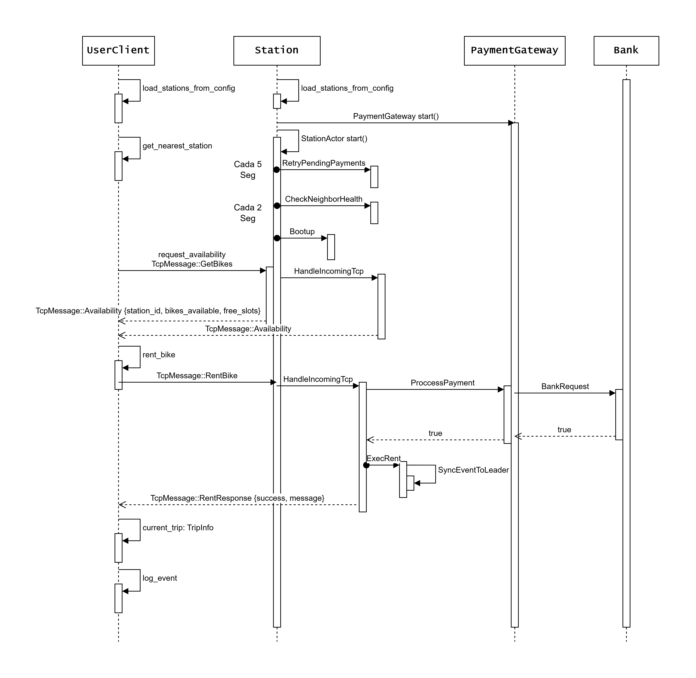
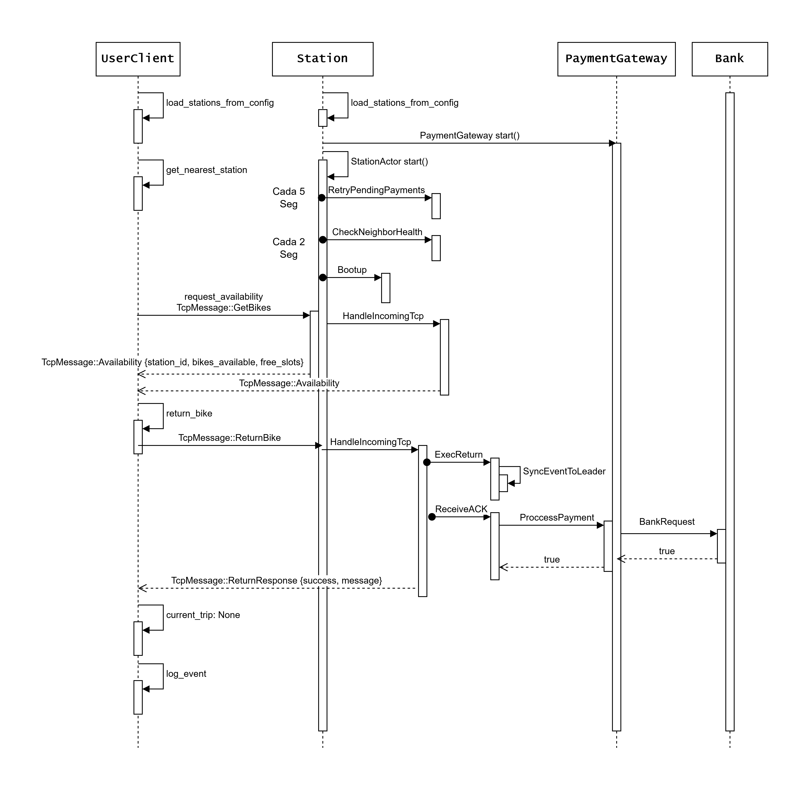
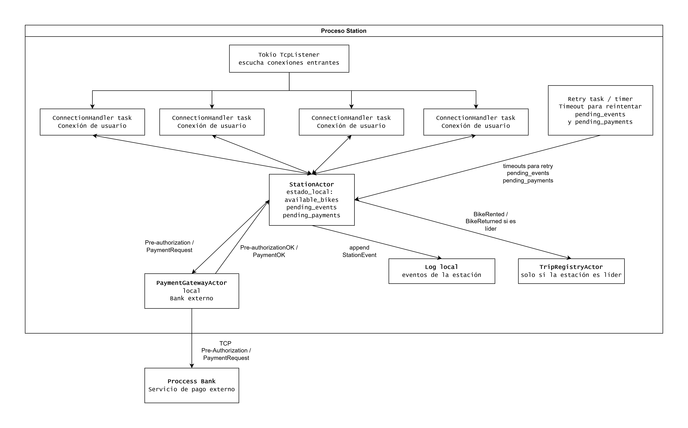

# Trabajo Práctico Bicicletas - Técnicas de Programación Concurrente

Sistema distribuido de alquiler de bicicletas escrito en Rust. Cada estación, cada usuario y el banco corren como procesos independientes que se comunican por TCP. Las estaciones están modeladas como actores (`actix`) y se organizan en un anillo lógico con elección de líder. El líder mantiene el registro global de viajes activos. El sistema sigue funcionando ante caídas o desconexiones de estaciones y usuarios.

## Integrantes
- Rivero Trujillo, Tobias - 106302
- Paz Blanco, Pilar - 105600
- Chen, Michelle Melisa - 105506

## Índice
- [Cómo ejecutar](#cómo-ejecutar)
- [Cambios desde la primera entrega](#cambios-desde-la-primera-entrega)
- [Tests](#tests)
- [Diseño final](#diseño-final)
- [Casos de uso](#casos-de-uso)
- [Diagramas de Flujo](#diagramas-de-flujo)
- [Anexo: diseño de la primera entrega](#anexo-diseño-de-la-primera-entrega)

## Cómo ejecutar

### Empezar una simulación desde cero

Cada proceso guarda un log en el directorio desde donde se lanzó y, al levantarse, **reconstruye su último estado a partir de ese log**. Para empezar una simulación limpia, primero hay que borrarlos:

```
rm -f station_*.log user_*.log bank_*.log
```

| Proceso  | Archivo de log           |
|----------|--------------------------|
| Estación | `station_<puerto>.log`   |
| Usuario  | `user_<user_id>.log`     |
| Banco    | `bank_4000.log`          |

### 1. Banco

```
cargo run --bin bank
```

Escucha en `127.0.0.1:4000`. Esta dirección es una constante (`BANK_ADDR`) que comparten el banco y el `PaymentGateway` de las estaciones.

### 2. Estaciones

Cada estación se lanza en su propia terminal:

```
cargo run --bin station <station_id> <max_slots> <ruta_config>
```

- `station_id`: tiene que existir en el archivo de configuración. Determina la dirección y el puerto de escucha.
- `max_slots`: cantidad de bicicletas iniciales. La estación `k` arranca con las bicis `(k-1)*max_slots + 1` a `k*max_slots`. La capacidad total de la estación es `max_slots + 3`, así queda lugar para recibir devoluciones desde el arranque.
- `ruta_config`: archivo con la topología de la red (`src/bin/config/cf2`).

Ejemplo:

```
Terminal 1: cargo run --bin station 1 10 src/bin/config/cf2
Terminal 2: cargo run --bin station 2 10 src/bin/config/cf2
Terminal 3: cargo run --bin station 3 10 src/bin/config/cf2
```

Esto levanta estaciones en los puertos 8001, 8002 y 8003, con las bicis 1-10, 11-20 y 21-30.

**Comandos por consola de la estación:**

| Comando       | Efecto |
|---------------|--------|
| `viajes`      | Muestra el registro global de viajes activos. Si la estación no es líder, la consulta viaja por el anillo hasta el líder. |
| `desconectar` | Simula una caída de red: avisa al anillo y deja de participar en él, pero sigue atendiendo usuarios. |
| `conectar`    | Vuelve a la red, se reintegra al anillo y sincroniza con el líder los eventos y pagos pendientes. |
| `Ctrl + C`    | Mata el proceso (caída real). |

### 3. Usuarios

Cada usuario se lanza en su propia terminal:

```
cargo run --bin cliente <pos_x> <pos_y> <user_id> <ruta_config>
```

- `pos_x`, `pos_y`: ubicación simulada del usuario. Se usa para elegir la estación más cercana.
- `user_id`: identificador del usuario. También define su archivo de log.
- `ruta_config`: archivo con todas las estaciones de la red (`src/bin/config/cf1`). En este archivo los IDs están en `0`. El cliente los actualiza con los IDs reales cuando ejecuta `get_bikes`.

Ejemplo:

```
cargo run --bin cliente 11 12 1 src/bin/config/cf1
```

El cliente se conecta a la estación viva más cercana (en este caso la 1) y queda listo para recibir comandos.

**Comandos por consola del usuario:**

| Comando                         | Efecto |
|---------------------------------|--------|
| `get_bikes`                     | Muestra las bicis disponibles y los slots libres de todas las estaciones alcanzables por el anillo. |
| `rent <station_id> <bike_id>`   | Alquila la bici indicada en esa estación. Se rechaza si el usuario ya tiene un viaje activo. |
| `return <station_id>`           | Devuelve la bici del viaje activo en esa estación. |
| `status`                        | Muestra el viaje activo, si lo hay. |
| `exit` / `quit`                 | Cierra el cliente. |

> Conviene ejecutar `get_bikes` antes del primer `rent` o `return`, para que el cliente conozca los IDs de las estaciones.

### Archivos de configuración

Una estación por línea, con el formato `id,x,y,ip:puerto`. Las líneas que empiezan con `#` se ignoran.

```
# src/bin/config/cf2
1,10,10,127.0.0.1:8001
2,20,20,127.0.0.1:8002
3,30,30,127.0.0.1:8003
4,40,40,127.0.0.1:8004
```

## Cambios desde la primera entrega

Después de la pre-entrega y de las charlas con el corrector, detectamos problemas centrales en el diseño. Por ejemplo, faltaba un binario extra para la entidad "banco" y faltaba uno de los requerimientos: la simulación de red caída. Además, durante el desarrollo encontramos varios bugs y errores de enfoque que dejaban al sistema en un estado inestable. Para corregirlo agregamos mensajes y actores, y ampliamos los actores que ya existían.

El diseño original se conserva al final, en el [anexo](#anexo-diseño-de-la-primera-entrega). Estas son las diferencias principales con respecto a ese diseño:

| Tema | Primera entrega | Entrega final |
|------|-----------------|---------------|
| Banco | Struct `Bank` con cuentas y saldos | Binario `bank` independiente que escucha por TCP y registra cada pago en su log |
| Pagos | Pre-autorización y cobro por `PaymentGateway` con timeouts | `PaymentGateway` abre una conexión TCP al banco por pago. Pre-autorización fija de $500 al alquilar. Al devolver se cobra `10 + 10 * minutos`, una vez que el líder confirma la devolución. Los cobros fallidos se encolan en `pending_payments`, se persisten en el log y se reintentan cada 5 segundos |
| Registro global | Actor `TripRegistry` en el líder | Campo `active_trips` del `StationActor`, que solo usa el líder. Se agrega `orphan_returns` para las devoluciones que llegan al líder antes que su alquiler |
| Identificadores | `Uuid` | `u32` (se dejó de usar el crate `uuid`) |
| Protocolo | Mensajes de texto (`RENT|user_id|...`) | Enum `TcpMessage` serializado en JSON con `serde`, un mensaje por línea |
| Topología | Cada estación conoce a su siguiente | Todas las estaciones conocen la red completa desde el config. Cada 2 segundos verifican a su vecino (`CheckNeighborHealth`) y reparan el anillo (`HealRing`) si se cae |
| Ingreso a la red | Se dispara una elección | La estación busca a su siguiente vivo y le pregunta `WhoIsLeader`. Si nadie responde, se autoproclama líder. Si hay vecino pero no hay líder, lanza una elección |
| Disponibilidad | Cada estación responde solo por sí misma; `FindBike` recorre el anillo | `get_bikes` envía `GetAllStationsAvailability`, que recorre el anillo y junta la disponibilidad de todas las estaciones |
| Alquiler | Reserva temporal (`ReserveBike`) antes de pre-autorizar | Sin reserva: la estación verifica que tiene la bici, pre-autoriza y ejecuta `ExecRent`. Si no tiene la bici, rechaza (el pedido no se propaga) |
| Red caída | No se simulaba | Comandos `desconectar` y `conectar` en la estación, con los mensajes `NodeDisconnected` y `NodeReconnected` y la lista `logically_dead` |
| Recuperación | Log local de eventos | La estación reconstruye bicis, contador de eventos, eventos pendientes y pagos pendientes desde su log. El usuario reconstruye su viaje activo desde el suyo. El nuevo líder pide los eventos pendientes al resto con `RequestPendingEvents` |
| Consola | No estaba definida | Comandos por consola para estaciones (`viajes`, `desconectar`, `conectar`) y usuarios (`get_bikes`, `rent`, `return`, `status`, `exit`) |

### Crates utilizados

| Crate | Uso |
|-------|-----|
| `actix`, `actix-rt` | Modelo de actores (`StationActor`, `PaymentGateway`) y runtime de las estaciones |
| `tokio` | Sockets TCP asincrónicos, tareas, timers y lectura de consola |
| `serde`, `serde_json` | Serialización de `TcpMessage`, eventos y logs en JSON |
| `chrono` | Timestamps de inicio y fin de viaje, cálculo de la duración |

## Tests

```
cargo test
```

- **Unitarios** (`src/models/station_actor.rs`, `src/bin/cliente.rs`):
  - `ExecRent` saca la bici y encola el `BikeRented`.
  - `ClosedTrip` elimina el alquiler pendiente.
  - La estación reconstruye su estado desde el log.
  - El usuario elige la estación más cercana.
  - El usuario recupera su viaje activo desde el log.
- **Integración** (`tests/tests_station.rs`, `tests/tests_client.rs`):
  - Disponibilidad por TCP.
  - Devolución aceptada y devolución rechazada por estación llena.
  - Alquiler exitoso y fallido del lado del cliente, contra una estación mock.
  - Devolución con viaje activo y sin viaje activo.

# Diseño final

## Actores
### Station
Actor principal del sistema, permite asignarle una cantidad de bicis, y una capacidad maxima. Cada estacion se conecta con otra a traves de su vecino, por medio de su direcion:puerto en el archivo de configuracion.
Cuando se dispone de varias estaciones vivas a la vez, esta se conectan por medio de topologia de anillo, referenciando a su vecino mas cercano.
Cada estacion se comunica por mensajes TCP con otras estaciones por medio del protocolo de estructura de mensajes creada para el sistema en formato json.
Estos mensajes tcp generan lanzamiento de mensajes del actor estacion.
Todas las estaciones conocen desde un incio a toda las estaciones existentes del sistema, para saber a quien acudir cuando su vecino esta caido.
```
struct StationActor {
    station_id: u32, //Id para identificar cada estacion de manera unica, para la estructura de anillo
    addr: String, //Direccion de la estacion
    location: (usize, usize),//representa la ubicacion
    max_slots: usize,//cantidad de slot maxima de bicicleta
    available_bikes: Vec<u32>, // bicicletas en la estacion
    leader: Option<StationInfo>,//Option de la estacion lider, porque puede no tener referencia
    known_stations: Vec<StationInfo>,//todas las estaciones conocidas
    next_station_addr: Option<String>, //mi vecino en el anillo
    payment_gateway: Addr<PaymentGateway>,//direccion del metodo de pago
    pending_events: VecDeque<StationEvent>,//cola de eventos pendientes para sincronizacion
    pending_payments: VecDeque<(PaymentMethod, f64, u32, u32)>,//cola de pagos pendientes para futuro cobro (payment, amount, user_id, station_id)
    active_trips: HashMap<u32, TripInfo>, // viajes abiertos,para mantener vision global de la red, solo el lider la usa
    orphan_returns: HashMap<u32, (String, StationEvent)>,//hashmap para devoluciones que llegaron al líder antes que el aviso de alquiler (por lag)
    log_path: PathBuf,//path del archivo para escribir el log de la estacion
    is_electing: bool,//si se esta en una eleccion de lider actualmente
    event_counter: u32,//contador de eventos para generar eventos unicos
    is_disconnected: bool, // Determina si la estación debe ignorar los eventos de anillo
    logically_dead: Vec<String>, // Lista de nodos que avisaron que se desconectaron, para no pingearlos
}
```
### Mensajes Station
```
Asumimos que no estoy solo en la red e intento unirme a la red de forma natural, le pregunto a mi vecino quién es el lider y actualizo. Si nadie me responde, significa que estoy solo y me autoproclamo líder
#[derive(Message)]
#[rtype(result = "()")]
struct Bootup;

Si pasó el tiempo y todavía no tenemos lider, es decir es None y además no estamos en elección lanzamos elección para elegir un nuevo líder
#[derive(Message)]
#[rtype(result = "()")]
struct VerifyLeaderTimeout;

Comienzo la elección en el anillo, y propago esta decision a mi vecino
#[derive(Message)]
#[rtype(result = "()")]
struct StartElection;

handleo de los mensajes recibidos por TCP, escucho por el socket y proceso la respuesta en base al mensaje recibido, desvio en el caso correspondiente, renta, devolucion, sincronizar, ack,etc, Autoenviandome el mensaje correspondiente. Es el nexo entre estaciones
#[derive(Message)]
#[rtype(result = "()")]
struct HandleIncomingTcp(TcpStream);

Si hay algun pago pendiente en la cola de pagos, intento enviar al actor payment gatwayt si es exitoso, lo desencolo, sino me envio el mensaje de que fallo y lo vuelvo a encolar
#[derive(Message)]
#[rtype(result = "()")]
struct RetryPendingPayments;

Encolo el pago pendiente en la cola
#[derive(Message)]
#[rtype(result = "()")]
struct EnqueueFailedPayment {
    payment: PaymentMethod,
    amount: f64,
    user_id: u32,
    station_id: u32,
}

Handleo de la operación de rentar una bici, actualizando todos los atributos del actor, encolando los eventos y avisando al líder de la transacción
#[derive(Message)]
#[rtype(result = "()")]
struct ExecRent {
    user_id: u32,
    bike_id: u32,
}

Handleo de la operación de retorno de bici, encola el evento pendiente, y avisa al líder que la operación termino.
#[derive(Message)]
#[rtype(result = "()")]
struct ExecReturn {
    user_id: u32,
    bike_id: u32,
    start_time: chrono::DateTime<chrono::Utc>,
    payment: PaymentMethod,
}

Handleo para setear el lider, luego lanzo tarea para rejecutar los eventos pendientes,ya que como se llavo a setear lider, este cambio y por lo tanto tenemos que sincronizar
#[derive(Message)]
#[rtype(result = "()")]
struct SetLeaderMsg {
    leader_id: u32,
    leader_addr: String,
}

Pruebo si mi siguiente normal (es decir mi id +1), esta vivo, si lo esta y me contesta, pero no era mi siguiente quiere decir que se callo por lo tanto lo vuelvo a incluir, si no esta vivo, mando mensaje a su siguiente y asi, hasta actualizar mi nuevo vecino, si mi vecino era el lider, llamo a eleccion
#[derive(Message)]
#[rtype(result = "()")]
struct CheckNeighborHealth;

tratamos de curar la red de anillo, si el que murio, era el lider mando a eleccion, sino solo actualizo mi vecino
#[derive(Message)]
#[rtype(result = "()")]
struct HealRing {
    dead_addr: String,
}

Actualizo mi vecino
#[derive(Message)]
#[rtype(result = "()")]
struct UpdateNextNode(String);

Me autodeclaro lider, porque estoy solo o quede solo
#[derive(Message)]
#[rtype(result = "()")]
struct DeclareSelfLeader;

Si soy el lider muestro el registro global de viajes, si no lo soy paso el mensaje a mi siguiente de esta forma siempre tenemos al lider como actor de la verdad
#[derive(Message)]
#[rtype(result = "()")]
struct ConsoleQueryTrips;

Handleo de mensaje para mantener sincronizada la red, el lider mantiene actualizado el estado global del sistema, si el lider arranca en blaco por ejemplo por una nueva votacion tengo que reconstruir todo los eventos pendientes, lanzo ráfaga de mensajes para ello
#[derive(Message)]
#[rtype(result = "()")]
struct SyncEventToLeader {
    origin_addr: String,
    event: StationEvent,
}

Hanldeo de los ACK, respuestas del lider a los avisos de recibidos. busca el id del evento que matchee el que se recibio,verifica que el lider haya confirmado la devolucion y por lo tanto puedo generar la informacion de cobro y luego lanzar una tarea para verificar que e pago se complete o no, si falla encolo a los pagos pendientes. Cuando se confirma, se elimina de la cola
#[derive(Message)]
#[rtype(result = "()")]
struct ReceiveAck(u32);

Hadleo del aviso que el viaje cerró, por lo tanto ya puedo eliminar el viaje de mi cola
#[derive(Message)]
#[rtype(result = "()")]
struct ReceiveClosedTrip(u32);

Handle para comenzar a reconstruir los eventos pendientes
#[derive(Message)]
#[rtype(result = "()")]
struct ReplayPendingEvents;

Sincronizamos eventos pendientes de pending_events de la estación con el líder 
#[derive(Message)]
#[rtype(result = "()")]
struct ExecuteReplay;

Handleo del mensaje de RingElection, si yo arranque la eleccion, entonces pegue toda la vuelta por lo tanto agarro el id mas alto, seteo al nuevo lider, relanzo los eventos pendientes y propago la decision, enviando a mi siguiente ringelected para comenzar a actualizar la red
#[derive(Message)]
#[rtype(result = "()")]
struct ProcessRingElection(Vec<u32>);

Proceso las decision de eleccion, si yo arranque y recibi el mensaje termino sino, actualizo este nuevo lider, le envio los pendientes para reconstruir y propagamos la decision
#[derive(Message)]
#[rtype(result = "()")]
struct ProcessRingElected {
    active_nodes: Vec<u32>,
    leader_id: u32,
    leader_addr: String,
    initiator_id: u32,
}

Si recibimos el mensaje WhoIsLeader y tengo algún líder, repondo la inforamción del líder
#[derive(Message)]
#[rtype(result = "()")]
struct ProcessWhoIsLeader(String);

Handleo el mensaje de pedido de viajes, si soy el lider tengo la fuete de la verdad sino , si el mensaje tiene "tiempo de vida" (ttl) propago el pedido a mi siguiente
#[derive(Message)]
#[rtype(result = "()")]
struct ProcessQueryTrips {
    origin_addr: String,
    ttl: usize,
}

Responde a la petición del nuevo líder forzando a la estación a vaciar su cola de pendientes
#[derive(Message)]
#[rtype(result = "()")]
struct RequestPendingEventsMsg {
    origin_addr: String,
    ttl: usize,
}

Permite aislar a la estación avisando al resto del anillo, mientras sigue atendiendo clientes. De esta forma se simula la desconexion de la red, pero permitiendo el funcionamiento con el usuario
#[derive(Message)]
#[rtype(result = "()")]
struct ConsoleDisconnect;

Volvemos a conectar la estacion a la red, y avisamos a los demas nodos que volvemos a estar  vivos
#[derive(Message)]
#[rtype(result = "()")]
struct ConsoleConnect;

Estos comandos son los que reciben los vecinos cuando la estación avisa que se desconectó
#[derive(Message)]
#[rtype(result = "()")]
struct RegisterDeadNode(String);

Actualizo el nodo que estaba simulando desconexion que se acaba de volver a conectar
#[derive(Message)]
#[rtype(result = "()")]
struct RegisterAliveNode(String);
```
### Funciones auxiliares
```
Función para flushear eventos al archivo log de la estación
    fn log_event(&self, event_desc: &str)

funcion auxiliar para enviar pagos y esperar de manera asincrona
    async fn send_payment(gateway: Addr<PaymentGateway>, payment: PaymentMethod, amount: f64, user_id: u32, station_id: u32) -> bool

Funcion asyncrona para enviar los mensajes a otra estacion partiendo de formato json, usa serde para serializar y enviar el por el TCP socket de tokio
    async fn send_tcp(addr: String, msg: TcpMessage) -> Result<(), std::io::Error>

Devuelve ID actual y suma uno al contador
    fn next_event_id(&mut self) -> u32

Actualizo el lider, verificando si antes yo era líder para limpiar mi registro de viajes
    fn set_leader(&mut self, leader_id: u32, leader_addr: String)

```
### PaymentGateway
Actor encargado de la comunicacion con el binario banco, para delegar los pagos y que este los "procese".
Comunica a la estacion si el banco respondio ok o error.
```
struct PaymentGateway {
    bank_addr: String,
}

impl Actor for PaymentGateway {
    type Context = Context<Self>;
}
```
### Mensajes PaymentGateway
```
///Recibe un pago, se conecta con el banco via tcp, y le delega este pago
/// informa por el channel si fue exitoso o no
#[derive(Message)]
#[rtype(result = "()")]
struct ProcessPayment {
    payment: PaymentMethod,
    amount: f64,
    user_id: u32,
    station_id: u32,
    reply_to: Option<tokio::sync::mpsc::Sender<bool>>,
}
```
## Struct utilizados
### Client
 Estructura para simular cliente, el cual actua como la "aplicacion movil" para interactuar por consola con la red de estaciones. Conoce por defecto todas las estacion de la red, al lanzar el binario de usuario este calcula cual es la estacion mas cercana de la red y se intenta conectar a esta, de fallar, pasar a la siguiente etc.
Por medio de la consola interacciona con el usuario y este redirige las consultas a la red.

```
pub struct UserClient {
    pub user_id: u32,
    pub location: Location,// ubicacion simulada del cliente
    pub known_stations: Vec<StationInfo>,//todas las estaciones  del sistema, cargada por archivo config
    pub payment_method: PaymentMethod,//Metodo de pago
    pub current_trip: Option<TripInfo>,//VIaje actual, o none
    pub trip_counter: u32,// contador de viaje para identificador de los viajes activos
    pub log_path: PathBuf
}
```
### Metodos del Client

```
Logeo de eventos para la reconstrucción, igual que en Station
    pub fn log_event(&self, event_desc: &str)

Extrae la lógia de cálculo de distancias 
    fn distance_to(&self, station: &StationInfo) -> isize

Me devuelve la estación más cercana de acuerdo a la distancia calculada
    pub fn get_nearest_station(&self) -> &StationInfo

Usado en get_bikes para que me devuelvan la estación más cercana viva
    pub async fn connect_to_network(&self) -> Option<TcpStream>

Busca una estación entre las estaciones conocidas local mediante su ID
    pub fn get_station_by_id(&self, id: u32) -> Option<&StationInfo>

Actualiza el ID de una estación entre las estaciones conocidas
    pub fn update_station_id(&mut self, addr: &str, new_id: u32)

Envia el mensaje `GetBikes` y espera la disponibilidad
    pub async fn request_availability(&mut self, addr: &str) -> Option<(u32, Vec<u32>, usize)>

formulacion de mensaje para rentar bici de una estacion y verificar el resultado
    pub async fn rent_bike(&mut self, addr: &str, bike_id: u32, target_station: StationInfo) -> bool

formulacion de mensaje para devolver bicicleta
    pub async fn return_bike(&mut self, addr: &str) -> bool

```
### Funciones auxiliares Client

```
Función para la recuperación del último viaje activo no cerrado del usuario como el usuario solamente puede tener un único current_trip, entonces solamente me importa la última línea del log, si la última línea es un ACTIVE_TRIP si es CLOSED TRIP significa que no hay ningún viaje activo 
    pub async fn recover_state_from_log(log_path: &PathBuf) -> Option<TripInfo>

Parsea un archivo de texto plano para construir la red de estaciones
    pub fn load_stations_from_config(path: &str) -> Vec<StationInfo>

```

### Payment_method

Estructura para simular metodo de pago. Deriva su serializacion al crate serde
para enviarlo como bytes de string y recibirlo como bytes de string y luego reconstruir el json

```
use serde::{Deserialize, Serialize};

#[derive(Serialize, Deserialize, Debug, Clone)]
pub enum PaymentMethod {
    /// Representa una tarjeta de crédito mediante su numeración
    CreditCard(String),
}
```

### Location
Estructura para representar la ubicacion, en coordeandas x,y. Deriva su serializacion y deserializacion a serde para trabajar en formato json

```
use serde::{Deserialize, Serialize};

/// Representa las coordenadas x,y
#[derive(Serialize, Deserialize, Debug, Clone, Copy)]
pub struct Location {
    pub location: (usize, usize),
}
```

### Station_event
Representamos los eventos que pueden suceder en una estacion que involucran sincronizar estado global
```
#[derive(Serialize, Deserialize, Debug, Clone)]
///Representamos los eventos que suceden en una estacion
pub enum StationEvent {
    BikeRented {
        event_id: u32,
        user_id: u32,
        station_id: u32,
        bike_id: u32,
        timestamp: DateTime<Utc>,
    },
    BikeReturned {
        event_id: u32,
        user_id: u32,
        station_id: u32,
        bike_id: u32,
        start_time: DateTime<Utc>,
        return_time: DateTime<Utc>,
        payment_method: PaymentMethod,
    },
}
```

### Station_info
Estructura que representa informacion clave de la estacion que es necesaria enviar
por mensaje. Deriva su serializacion y deserializacion a serde para trabajar con formato json

```
use serde::{Deserialize, Serialize};

#[derive(Serialize, Deserialize, Debug, Clone)]
pub struct StationInfo {
    pub station_id: u32,
    pub location: (usize, usize),
    pub addr: String,
}
```

### trip_info
Estructura para almecenar la informacion de un viaje en curso y poder enviar y recibir la informacion de manera mas sencilla. Por ejemplo para cuando queremos enviar la inicializacion de un viaje al lider. Deriva su serializacion y deserializacion a serde para poder trabajar con formato json. Utiliza Chrono para sacar timestamp del momento exacto en que sucede el viaje

```
use chrono::{DateTime, Utc};
use serde::{Deserialize, Serialize};
use crate::models::station_info::StationInfo;

#[derive(Serialize, Deserialize, Debug, Clone)]
///Informacion del viaje para operaciones
pub struct TripInfo {
    pub trip_id: u32,
    pub current_bike_id: u32,
    pub start_time: DateTime<Utc>,
    pub last_owner_station: StationInfo,
}
```

### Tcp_message
Estructa fundamental para la comunicacion entre estaciones, definimo un protocolo de comunicacion por tcp con la siguiente estructa y de esta menera al recibir algo por stream TCP, podemos matchear el caso y derivar el curso de accion.
Ademas esta estructura nos permite extender comportamiento en caso de necesitar nuevas funcionalidades, sirve como un buen punto de entrada entre estaciones.
Utilizamos serde, para trabajar con formato json
```
use serde::{Deserialize, Serialize};
use crate::models::payment_method::PaymentMethod;
use crate::models::trip_info::TripInfo;
use crate::models::station_event::StationEvent;

/// Protocolo de comunicación serializable sobre TCP.
#[derive(Serialize, Deserialize, Debug, Clone)]
pub enum TcpMessage {
    GetBikes,
    Availability {
        station_id: u32,
        bikes_available: Vec<u32>,
        free_slots: usize,
    },
    GetAllStationsAvailability {
        origin_station_id: u32, 
        // (station_id, station address, available_bikes, free_slots)
        stations_availability: Vec<(u32, String, Vec<u32>, usize)> 
    },
    RentBike {
        user_id: u32,
        bike_id: u32,
        payment_method: PaymentMethod,
    },
    RentResponse {
        success: bool,
        message: String,
    },
    ReturnBike {
        user_id: u32,
        bike_id: u32,
        payment_method: PaymentMethod,
        trip_info: TripInfo,
    },
    ReturnResponse {
        success: bool,
        message: String,
    },
    WhoIsLeader {
        origin_addr: String,
    },
    RingElection {
        active_nodes: Vec<u32>,
    },
    RingElected {
        active_nodes: Vec<u32>,
        leader_id: u32,
        leader_addr: String,
        initiator_id: u32, 
    },
    RequestPendingEvents {
        origin_addr: String,
        ttl: usize,
    },
    SyncEvent {
        origin_addr: String,
        event: StationEvent,
    },
    EventACK {
        event_id: u32,
    },
    ClosedTrip {
        bike_id: u32,
    },
    
    QueryTrips {
        origin_addr: String,
        ttl: usize,
    },
    QueryTripsResponse {
        trips: Vec<TripInfo>,
        error: bool,
    },
    NodeDisconnected {
        dead_addr: String,
    },
    NodeReconnected {
        alive_addr: String,
    },
}
```

## Casos de uso
Teniendo 1 station y 1 user, banco funcionando
Lanzo un binario station, el cual desde el archivo de config + los argumentos seteara todo lo necesario para el actor station, que se levantar en el binario.
Desde este momento, cuando el actor inicie y chequee su siguiente director y posteriormente las demas estaciones se dara cuenta que esta solo, por lo tanto se autoproclama lider.
Ahora lanzamos el binario cliente, este con el archivo de configuracion cargara las estacion de la red, y en base a su posicion se conectara a la mas cercana, en caso de no estar la mas cercana informara esto y se conectara a la siguiente mas cerca disponible.
### 1- Obtener las bicis
Ahora tenemos 1 usuario (*u1*) conectado a la estacion 1 (*s1*):
- se escribe get_bikes por consola u1.
- u1 crea un tcp_message del enum "get_bikes" lo serializada con serde y lo envia por el socket a su estacion mas cercana.
- u1 no se bloquea esperando respuesta, pues se utiliza socket asincronos de tokio
- a s1 le llega un un mesaje por sokcet, deserializa y verifica que clase de tcp_message llego.
- matchea el caso de uso y detecta que fue un GetAllStationsAvailability.
- s1 actua en base a esto, como esta conectada a la red, deberia propagar este mensaje a los demas en la red, pero como no tiene siguiente crea una respuesta para el usuario, añade sus bicis y escribe por el socket.
-u1 estaba escuchando por medio de una tarea asincrona la respuesta, detecta esta respuesta, deserializa el tcp_message y muestra por pantalla las bicis libres.

### 2- Rentar bici 2 de estacion 1
- En el binario u1,introducimos "rent 1 2".
- Dentro u1 se procesa este input, se verifica que sea valido y luego envia un mensaje a su estacion mas cercana bajo el protocolo tcp_message, en donde incluye los datos de la bici y estacion.
- u1 crea el mensaje tcp_message rentbike y envia por socket a la estacion mas cercana s1, en este caso.
- Dentro de s1, a traves de listener del socket asincrono detecta paquetes, deserializa, detecta un tcp_message y matchea el caso, en este caso RentBike.
- En este momento s1 revisa si tiene esta bici. Si no la tiene, responde `RentResponse` con `success: false` ("Denegado o falta stock"); el pedido no se propaga por el anillo.
- Como s1 tiene esta bici, primero pide al `PaymentGateway` la pre-autorizacion de $500. Si el banco la confirma, se auto envia el mensaje `ExecRent` y trabaja en base a esto.
- Dentro s1 al recibir el mensaje exec rent, usa su handler y comienza a operar.
- s1 crea el evento "bikerented", se encolo en pending events de la estacion.
- s1 flushea esto en el log fisico.
- s1 se envia el mensaje synctoleader, para informar al lider de este evento para que el mismo, actualice la fuente de la verdad.
- s1 es el lider por lo que recibira este mensaje y actualizara el registro de la verdad.
- Ademas de sincronizar con el lider, s1 responde a u1 con la bici rentada, serializando el mensaje RentResponse.
- u1 recibe la respuesta por socket, deserializa, y crea un struc trip con dicha bici, si esto fallara muestra por pantalla alquiler denegado.

### 3- Devolver bici a estacion 1
- en la consola del binario usario se ingresa return 1. Notese que solo se especifica en que estacion devolver ya que no interesa el id de la bici.
- u1 procesara el input, verificara que tenga sentido, es decir que tenga una bici que devolver, que el id de estacion sea un numero valido etc y en caso correcto creara un tcp message para comunicarse ,en este caso, con s1 y enviara por el socket  returnbike, que incluira el id de la bici.
- s1 detectara por el puerto la llegada de paquetes, deserializara y obtendra el tcp_message, luego matcheara el caso, y procesara returnbike.
- s1 verificara que tiene espacio para alojar la bici, si no lo tiene, creara un tcp_message de respuesta en donde incluira que no pude devolver la bici e imprimira por su consola el mensaje.
- como si tiene espacio s1, procedera, se autoenviara el mensaje execreturn y a su vez avisara a u1 por tcp, con una respuesta de ok.
- al recibir el mensaje de actor exectReturn s1 comenzara la operacion,encolara el id de bici, creara un evento de returnbike, con los datos de s1 y la bici.
-s1 encola el evento en eventos pendientes, logueara el evento en disco, acto seguido logueamos que se añadio un evento pendiente por si caemes antes de que el lider sincronice
- s1 comunicara por pantalla que se acepto la devolucion y procedera a enviarse el mensaje de actor para sincronizar con el lider.
- u1 ya habra visto que su retorno fue valido y puede seguir operando.

### 4- Operar sin banco funcionando
- **Alquiler:** si el banco esta caido, la pre-autorizacion falla y la estacion responde `RentResponse` con `success: false` ("Banco fuera de servicio"). La bici no se libera.
- **Devolucion:** la devolucion se acepta igual. Cuando el lider confirma el `BikeReturned`, la estacion intenta cobrar; si el banco no responde, el cobro se encola en `pending_payments` (y se persiste en el log) y se reintenta cada 5 segundos hasta que el banco vuelva a estar disponible.

### 5- Devolver a estacion 1 (sin haber alquilado)
- u1 intenta devolver una bici a la estacion 1, como no tiene viajes activos, se rechaza la operacion

### 6- Rentar en station 1 la bici 1, luego otro usuario trata de rentar bici 1
- u1 renta bici 1 de station 1.
- operacion exitosa s1 devuelve el ok a u1 ademas de validar y actualizar todo como mencionamos antes.
- u1 intenta rentar bici 1 de station 1.
- u1 ya tiene bici rentada, rechazo automatico

### 7- Rentar una bici que fue alquilada
- supongamos que un usuario u2, realiza rent 1 1.
- s1 responde ok entrega la bici y actualiza todo.
- u2 ahora tiene viaje con bici 1.
- u1 ahora intenta hacer rent 1 1.
- s1 recive la peticion y al buscar dicha bici, no la encuentra por lo tanto genera como respuesta un rechazo de la peticion.
- u1 recibe la respuesta e imprime por pantalla que no se pudo alquilar.

### 8- Rentar bici que no existe en la estacion
- u1 realiza rent 1 400.
- s1 recibe la peticion, busca la bici no la encuentra y rechaza el alquiler.
- u1 recibe el rechazo e imprime por pantalla la falla del alquiler.

### 9 - Entra una nueva estacion en la red
- s1 esta viva.
- En otra terminal lanzamos una estacion nueva (s3=id=3). 
- s3 se levanta, s3 no asume que esta sola sino que verificara si se puede conectar a su vecino ideal (suponiendo una red total de 4 estaciones) intentara conectarse a 4, esta falla, ira al siguiente 1.
- s3 se podra conectar a s1, entonces actualizara su vecino ahora s1.
- s3 aprobecha y consulta a su vecino "quien es el lider"? por tcp message whoisleader.
- s1 recibira el mensaje y actuara al respecto verificara si tiene lider y en caso positivo responde quien es el lider.
- s3 recibe esta respuesta por tcp y actualiza el lider.
- Ademas, s1 durante este proceso va a detectar que no tiene un vecino, al revisar si este vecino esta vivo, y en este proceso termina iterando la primera estacion mas cercana que le responda y en esta busqueda detectara que s3 responde y actualizara su vecino.
- Al terminar este proceso s1 -> s3 -> s1.
- El anillo esta activo y correctamente conectado.

### 10 - Cae el lider (desconectado) eleccion
- s1 se desconecta de la red.
- s3 al poco tiempo al chequear si su vecino sigue vivo, detecta que es no lo esta.
- s3 intenta actualizar su siguiente, no lo encuentra porque no hay otra estacion viva.
- A su vez s3 sabe que su vecino callo y ademas era lider, lanza eleccion.
- s3 lanza por tcp a su siguiente starelection. 
- Como s3 esta solo, nadie mas detecta esto.
- Pero como esta sola s3, va a autoproclamarse lider.
- s3 es ahora lider.

### 11 - Cae el lider (ctrl + c) eleccion
- s1 se cae.
- s3 al poco tiempo al chequear si su vecino sigue vivo, detecta que es no lo esta.
- s3 intenta actualizar su siguiente, no lo encuentra porque no hay otra estacion viva.
- A su vez s3 sabe que su vecino callo y ademas era lider, lanza eleccion.
- s3 lanza por tcp a su siguiente starelection. 
- Como s3 esta solo, nadie mas detecta esto.
- Pero como esta sola s3, va a autoproclamarse lider.
- s3 es ahora lider.

### 12 - Renta con  desconexion s1 de la red.
- s1 se desconecta de la red.
- Ademas de suceder el casi 10 nuevamente.
- s1 esta caida de la red, pero sigue funcionando.
- u1 puede enviar rent 1 1 correctamente, el socket sigue abierto.
- s1 recibe el mensaje y procesa todo correctamente entrega la bici.
- s1 no tiene siguiente porque esta desconectada, lo detecta y por lo tanto agrega el evento a la cola de enventos y el pago a la cola de eventos puesto que no tiene comunicacion con ellas.
- u1 se va con su bici.
- s1 vuelve a conectarse a la red, se intenta conectar a su siguiente mas cercano y sino al siguiente etc.
- s1 al lograr la conexion, comienza a syncronizar todos los eventos pendientes y pagos.
- s1 ahora envia en rafaga todas las operaciones que sucedieron al lider.

### 13 - renta y retorno con desconexion
- s1 se desconecta de la red.
- s3 actualiza lider, reconstruye el anillo etcc.
- u1 renta de s1, la operacion sale bien, s1 responde ok.
- u1 devuelve la bici a station 1.
- s1 la recibi y devuelve ok.
- s1 se reconecta a la red.
- s1 se integra al anillo de forma correcta actualiza el lider.
- s1 comienza a sincronizar los eventos con el lider, enviando tanto el rent y el return para su posterior desencole de pagos, una vez que se confirma tanto el alquiler como luego el retorno.

## Diagramas de Flujo

Diagramas de flujo de los casos felices de alquiler y devolución de bicicletas. Se muestra la interacción de StationActor con el actor PaymentGateway. Y la interacción del actor PaymentGateway con el proceso Bank. No se muestra del todo la interacción con el resto de las estaciones de la red. 

### RENT 

### RETURN 


# Anexo: diseño de la primera entrega

> Este es el diseño presentado en la pre-entrega, sin cambios. Algunas partes ya no coinciden con la implementación final; las diferencias están resumidas en [Cambios desde la primera entrega](#cambios-desde-la-primera-entrega).

## Diseño y Estructuras

A continuación se describen los principales mecanismos que serán utilizados en el diseño del sistema:  

| Mecanismo | Uso | Justificación |
| :---: | :---: | :--- |
| Modelo de Actores | `Station`, `User`, `PaymentGateway`, `TripRegistry` | Se utiliza para encapsular estado interno mutable y procesar mensajes de forma secuencial. Así, se evitan accesos concurrentes directos sobre estructuras compartidas |
| TCP con tokio | Comunicación asíncrona entre procesos independientes | Se utiliza para la comunicación entre aplicaciones ejecutadas en procesos distintos:  Conexión de `User` con `Station`, conexión de `Station` con `PaymentGateway`, conexión de `Station` con la siguiente `Station` en el anillo y con la estación `leader`. Tokio permite manejar conexiones TCP, tareas, timeouts y reintentos de manera asíncrona |
| Algoritmo de Anillo | Elección de líder | Las estaciones se organizan en un anillo lógico. Cada estación conoce la siguiente estación del anillo. El líder mantiene `TripRegistry` que registra los viajes activos y cerrados a partir de los eventos de sincronización enviados por las estaciones |
| Registro de Estados Globales | Prevención de un único punto de fallo | Cada estación mantiene una cola local de `pending_events` con los eventos que generó y que todavía no fueron confirmados por el líder, por ejemplo inicios o cierres de viaje. La estación envía estos eventos al líder, pero no los elimina de su cola hasta recibir un `ACK`. El líder mantiene el `TripRegistry`, que registra los viajes activos y cerrados de todas las estaciones a partir de esos eventos. Cuando una bicicleta es devuelta en cualquier estación, dicha estación genera un evento de cierre de viaje y lo envía al líder. Una vez que el líder actualiza el `TripRegistry` y confirma el evento, la estación que envió el cierre puede eliminarlo de sus `pending_events` |
| Coordinación de Pagos y Sincronización Eventual | Alquiler de bicicleta | Se utiliza para coordinar la reserva local de una bicicleta, la pre-autorización y el registro del viaje local y en el líder. Si falla la pre-autorización, se aborta la operación de alquiler y la bicleta no se desbloquea al usuario |
| Timeouts y reintentos | Pre-autorización y comunicación con servicio externo | Si una pre-autorización falla o expira durante un alquiler, la bicicleta no se entrega. Si falla un cobro durante una devolución, la bicicleta se acepta igualmente y el cobro se encola en `pending_payments` para reintarlo más tarde hasta lograrlo |
| Log | Recuperación ante caídas | Cada estación mantiene un log local con los eventos relevantes, como inicio, cierre de viajes y el estado de la estación. Si una estación se cae, puede reconstruir su estado local desde log |

## Panorama del Sistema


## Estación



Cada estación se modela como un proceso independiente que ejecuta un Actor `Station`.

La aplicación usuario se conecta directamente a una estación cercana para consultar disponibilidad, alquilar y devolver una bicicleta. Esta conexión usuario-estación se modela mediante TCP. 

La estación posee: 
- `station_id`: Un identificador de la estación.
- `max_slots`: Capacidad total de la estación. 
- `available_bikes`: Una lista de identificadores de bicicletas actualmente disponibles en la estación. 
- `listener`: Un TcpListener para escucha de conexiones de entrantes que podría ser un usuario u otra estación. 

No se modela cada slot individualmente, alcanza con conocer la capacidad máxima de la estación y la lista de bicicletas disponibles. La cantidad de lugares libres se calcula como:

`free_slots = max_slots - available_bikes.len()`

Cuando un usuario alquila una bicicleta, la estación remueve el `bike_id` elegido. Cuando un usuario devuelve una bicicleta, la estación verifica que haya lugar libre y luego agrega el `bike_id` a `available_bikes`. 

La estación mantiene dos colas colas: 
- `pending_events`: Eventos generados localmente que todavía no fueron confirmados por el líder. Por ejemplo, eventos de inicio o cierre de viaje pendientes de sincronización. 

- `pending_payments`: Cobros que no pudieron procesarse y deben reintentar más tarde. 

### Algoritmo de Anillo 

Elegimos el algoritmo del anillo para minimizar la cantidad de mensajes enviados. 

Las estaciones se organizan en un anillo lógico. Cada estación conoce a la siguiente estación del anillo y mantiene una lista de estaciones conocidas para poder recomponer el anillo ante caídas.

El anillo se utiliza principalmente para la elección de un nuevo líder cuando el líder actual deja de responder. La caída del líder se detecta mediante timeout al intentar comunicarse con él.

El campo `leader` almacena la información de la estación que actualmente cumple el rol de líder.

La estación líder es la única que ejecuta localmente el actor `TripRegistry`. Este Actor mantiene el estado global de los viajes activos y cerrados. El actual líder recibe los eventos de sincronización de las demás estaciones y se las comunica al `TripRegistry`. Específicamente, el Actor `TripRegistry` se corre localmente dentro de cada proceso estación, pero si la estación no es líder, se comunica con el líder mediante TCP guardado en `leader` para registrar nuevos viajes o viajes cerrados. 

Cuando una estación genera un evento que debe ser registrado globalmente, lo agrega primero a pending_events y lo envía al líder. La estación no elimina ese evento de pending_events hasta recibir un `ACK`. Si no recibe confirmación, conserva el evento y lo reintenta más tarde. 

Si el líder cae, las estaciones inician una elección mediante el algoritmo de anillo. Una vez elegido el nuevo líder, cada estación actualiza su campo `leader` y reenvía los eventos pendientes de su cola `pending_events`. De esta manera, el nuevo líder puede reconstruir el estado del `TripRegistry`.

Si se agrega una nueva estación, se dispara elección de líder nuevo. 

Además, cada estación mantiene un log local que registra todos los eventos de la propia estación que sirve para la reconstrucción del último estado de la estación en caso de que la estación caiga. 

~~~

Struct Station {
    station_id: Uuid
    max_slots: usize,
    available_bikes: Vec<Uuid>,  
    listener: Option<TcpListener>, // TcpListener de tokio,

    leader: StationInfo,
    known_stations: Vec<StationInfo>, 
    next_station: Option<StationInfo>, 

    payment_gateway: Addr<PaymentGateway>,

    // pending_events solamente quita un evento de prestar bicicletas 
    // fue notificada a través del líder sobre la devolución 

    pending_events: VecDeque<StationEvent>,
    pending_payments: VecDeque<PaymentRequest>,

    // El campo active_trips_registry solo es Some (...) si la estación actual es el líder. 
    // Para estaciones no líderes, este campo es None, 
    // ya que se comunican con el TripRegistry enviado mensajes al líder mediante TCP

    active_trips_registry: Option<Addr<TripRegistry>>
    log_path: PathBuf, 
}

enum StationEvent {
    BikeRented {
        event_id: Uuid, 
        user_id: Uuid, 
        station_id: Uuid, 
        bike_id: Uuid, 
        timestamp: DateTime<Utc>
    }

    BikeReturned {
        event_id: Uuid, 
        user_id: Uuid, 
        station_id: Uuid, 
        bike_id: Uuid, 
        timestamp: DateTime<Utc>
    }

}

struct StationInfo {
    station_id: Uuid,
    // Ubicación geográfica en coordenadas (provisional) 
    // location: Location, 
    addr: SocketAddr, 
    socket: Option<TcpStream>
}

struct PaymentGateway {
    payment_service_addr: SocketAddr, 
    peding_payment_events: VecDeque<PaymentRequest>, 
}

struct Bank {
    accounts: HashMap<CreditCard, Balance>, 
}
~~~

### Sincronización de Viajes Activos y Eventos Pendientes

Cada estación mantiene una cola `pending_events` con los eventos locales que generó y que todavía no fueron confirmados por el líder. Estos eventos pueden representar, por ejemplo, el inicio de un viaje (`BikeRented`) o el cierre de un viaje (`BikeReturned`).

Cuando una estación presta una bicicleta, genera un evento `BikeRented` y lo envía al líder. Si el líder registra correctamente el evento en el `TripRegistry`, responde con `ACK`. 

Una vez confirmado el evento `BikeRented`, el viaje queda abierto en el `TripRegistry` del líder. La estación de origen mantiene ese evento como pendiente hasta que la bicicleta sea devuelta. 

Cuando el usuario devuelve la bicicleta en cualquier estación, la estación de devolución genera un evento `BikeReturned`. Esta estación acepta la bicicleta localmente si tiene lugar disponible, registra el evento en su log local y lo agrega a `pending_events`. Luego intenta enviarlo al líder.

Si el líder recibe el evento `BikeReturned`, cierra el viaje activo en el `TripRegistry`, registra la estación de devolución y responde `ACK` a la estación que informó la devolución. El líder, además, envía un mensaje de `ClosedTrip` a la estación que había alquilado la bicicleta para informar sobre la devolución. 

Si la estación que recibe la devolución no puede comunicarse con el líder, mantiene el evento `BikeReturned` en `pending_events` y lo reintenta más tarde. La devolución física de la bicicleta queda aceptada localmente, pero la sincronización global del viaje queda pendiente hasta recuperar conexión con el líder o hasta que se elija un nuevo líder.

Si el líder cae, las estaciones detectan la falla por timeout e inician una elección mediante el algoritmo de anillo. Una vez elegido el nuevo líder, cada estación reenvía los eventos que todavía tenga en `pending_events`, permitiendo reconstruir el estado del `TripRegistry`.

### Coordinación con Pagos y Sincronización Eventual: Pre-autorización y Pago

El servicio de pago se modela como un proceso independiente. Dentro de cada estación existe un actor local `PaymentGateway`, encargado de encapsular la comunicación con el servicio de pagos externos. El Actor `Station` no se comunica directamente con el banco, sino que envía solicitudes de pre-autorización y cobro al Actor `PaymentGateway`. Este úlitmo se encargará abrir la conexión con el servicio externo de pagos, enviar las solictudes, esperar la respuesta, devolver la respuesta a la estacíon y reintentar en caso de timeout. 

La estación mantiene autoridad sobre su estado físico local y prioriza que el alquiler y la devolución puedan resolverse localmente, incluso si temporalmente no hay conexión con el líder.

Para el caso de **RENT**: 
1. La estación manda las disponibilidad al usuario. 
2. El usuario elige el ID de la bicicleta que desea alquilar. 
3. La estación reserva temporalmente la bicicleta pedida. 
4. La estación solicita al `PaymentGateway` la pre-autorización del monto de seguridad. 
5. Si la pre-autorizaición falla o expira por tiemout, la estación cancela la reserva y no libera la bicicleta. 
6. Si la pre-autorización es exitosa, la estación libera la bicicleta al usuario. 
7. La estación registra localmente el evento `BikeRented` en su log y encola el evento en `pending_events`. 
8. La estación intenta informar el inicio de viaje al líder para que este actualice el `TripRegistry`. 
9. El líder responde con `ACK`.
10. Si el líder no responde, la estación dispara elección del líder: 
    - Si no responde el resto de las estaciones, significa que la estación está desconectada del resto. Se proclama líder e reintenta hasta obtener respuesta de alguna del resto de las estaciones. 
    - Si alguna de las estaciones responde al mensaje de elección, significa que el líder está caído, se elije un nuevo líder y todas las estaciones envían sus eventos pendientes para reconstruir el `TripRegistry`.

Para el caso de **RETURN**:
1. La estación manda las disponibilidad al usuario. 
2. El usuario manda solicitud de devolución junto con el ID de la bicicleta a devolver. 
3. Si no hay lugar en la estación, se rechaza la devolución. 
4. Si hay lugar, acepta la bicicleta localmente. 
5. La estación registra localmente el evento de `BikeReturned` en su log y encola el evento en `pending_events`.  
7. La estación intenta informar el cierre de viaje al líder para que este actualice el `TripRegistry`. 
8. La estación calcula el monto a cobrar usando el timestamp actual, el timestamp de inicio de viaje mandado por el usuario y el precio por minuto (en caso de que se pierda el timestamp de comienzo en la apliación usuario, la estación obtiene la información desde el líder).
9. La estación se comunica con `PaymentGateway` para cobrar el monto calculado. 
10. Si el cobro falla por timeout o error de conexión, la devolución se mantiene aceptada y el cobro se encola en `pending_payments`. 
11. `PaymentGateway` reintentará hasta lograr el cobro. La estación recibirá la confirmación de `PaymentGateway` cuando éste logre resolver los pagos pendientes.
12. La estación informa al líder sobre la devolución de la bicicleta. 
13. El líder al recibir el aviso de devolución responde `ACK`. 
14. El líder cierra el viaje activo de la bicleta devuelta. Si la estación de alquiler es distinta de la estación de devolución, el líder notifica a la estación de alquiler la devolución de la respectiva bicicleta para que cierre el viaje activo pendiente.   
15. La estación de alquiler de la bicicleta devuelta, una vez que reciba la notificación del líder desencola de `pending_events` el evento de `BikeRented` de la bicicleta devuelta. 


### Consulta de Ubicación de una Bicicleta

El líder mantiene el estado global de los viajes activos y cerrados mediante el `TripRegistry`, pero no necesariamente mantiene en todo momento una copia completa del estado físico de cada estación.

Para consultar en qué estación se encuentra una bicicleta, se utiliza el anillo de estaciones. La estación que recibe la consulta envía un mensaje `FindBike(bike_id)` a la siguiente estación del anillo. Cada estación verifica localmente si la bicicleta se encuentra en su lista `available_bikes`. Si la encuentra, responde con su `station_id`. Si no la encuentra, reenvía la consulta a la siguiente estación.

Este enfoque evita que cada cambio local de bicicletas tenga que ser comunicado inmediatamente a todas las estaciones o al líder. En lugar de mantener una copia global completa y constantemente actualizada, se consulta la ubicación de una bicicleta bajo demanda.

Si una estación está caída o desconectada, no podrá responder si la bicicleta se encuentra allí. En ese caso, la consulta puede quedar incompleta o responder que la ubicación no pudo determinarse temporalmente. 

### Persistencia

Cada estación mantiene un log local en `log_path`. Antes de confirmar una operación relevante, escribe el evento en el Log. Esto permite recuperar el estado local de una caída y reenviar al líder los eventos que hayan quedado pendientes a sincronizar. 

El líder también mantiene un log global de los viajes activos. Si cae y se elige un nuevo líder, las estaciones reenvían los eventos eventos pendientes para reconstruir `TripRegistry`. 

``` 
enum StationEvent {
    BikeRented {
        event_id: Uuid, 
        user_id: Uuid, 
        station_id: Uuid, 
        bike_id: Uuid, 
        timestamp: DateTime<Utc>
    }

    BikeReturned {
        event_id: Uuid, 
        user_id: Uuid, 
        station_id: Uuid, 
        bike_id: Uuid, 
        timestamp: DateTime<Utc>
    }
}
```

## Usuario
La aplicación Usuario se modela como un proceso independiente encargado de iniciar las operaciones de **RENT** (alquiler de bicicleta) o **RETURN** (devolución de bicicleta) de bicicletas. Cada usuario posee:

- `user_id`: Un identificador único 
- `location`: Una ubicación actual 
- `known_stations`: Una lista de todas las estaciones disponibles 
- `payment_method`: Un método de pago 
- `TripInfo`: La información del viaje actual, si el usuario pidió prestado de bicicleta
- `socket`: Un socket TCP para la comunicación con la estación  

``` 
struct User {
    user_id: Uuid,
    location: Location, 
    known_stations: Vec<StationInfo>, 
    payment_method: Option<PaymentMethod>
    current_trip: Option<TripInfo>
    socket: Option<TcpStream> // de tokio
}

struct Location {
    coords: (usize, usize)
}

enum PaymentMethod {
    CreditCard(String)
}

// La lista de estaciones contiene, para cada estación, 
// su ubicación en coordenadas y la dirección de la red necesaria par conectarse a ella
struct StationInfo {
    coords: (usize, usize)
    addr: SocketAddr
}

struct TripInfo {
    trip_id: Uuid, 
    current_bike_id: Uuid, 
    start_time: DateTime<Utc>, 
    last_owner_station: StationInfo
}
```
El campo known_stations contiene la información necesaria para que el usuario pueda elegir una estación y conectarse a ella. Para elegir una estación, la aplicación calcula la distancia euclideana entre su ubicación actual y la ubicación de cada estación conocida.

Una vez elegida la estación, el usuario abre una conexión mediante TcpStream usando el SocketAddr almacenado en `StationInfo`. A través de esa conexión recibe el mensaje de información de disponibilidad de parte de la estación y envía el mensaje correspondiente:

- **RENT**: Si quiere alquilar una bicicleta. 

Ejemplo de mensaje: 
    RENT|user_id|bike_id|credit_card

- **RETURN**: Si quiere devolver una bicicleta. 

Ejemplo de mensaje:
    RETURN|user_id|bike_id|start_time|last_owner_station_id|credit_card|

El usuario mantiene un campo `current_trip` que contendrá la información del viaje activo con `TripInfo` que posee: 
- `trip_id`: Identificador el viaje activo
- `current_bike`: Identificador de la bicicleta 
- `start_time`: Timestamp del inicio del viaje
- `last_owner_station`: Información de la estación de donde el usuario pidió prestado de la bicicleta. 

Para evitar que la información del viaje activo dependa solamente de la aplicación usuario, esta información del viaje activo también la registrará el líder de las estaciones como se ha explicitado anteriormente. 

## Mensajes

Nuestro sistema está compuesto por procesos independientes: 
- Aplicación Usuario 
- Estaciones
- Medio de Pago - PaymentGateway

Las comunicaciones entre procesos se realizan mediante TCP. Dentro de cada proceso, los componentes modelados como actores se comunican a través de mensajes internos y los mensajes son procesados de manera secuencial. 

### Alquiler de Bicicleta

El usuario calcula la distancia a la estación y se conecta a la estación más cercana a través de una conexión TCP. Si la conexión fue exitosa obtiene un TcpStream para la comunicación.  

| Emisor | Receptor | Mensaje | Comportamiento |
| :---: | :---: | :---: | :--- |
| Station | User | Availability { station_id: Uuid, bikes_available: Vec<Uuid>, free_slots: usize } | Una vez que el usuario se conecta a la estación más cercana, la estación le envía las bicletas y los slots libres que tiene disponibles |
| User | Station | RentBike { user_id: Uuid, bike_id: Uuid, payment_method: CreditCard } | El usuario elige la bicicleta `bike_id` que desea alquilar y envía una solicitud con el identificador junto con el medio de pago y su propio identificador a la estación |
| Station | Station | ReserveBike { user_id: Uuid, bike_id: Uuid } | La estación reserva momentáneamente la bicicleta elegida por el usuario |
| Station | PaymentGateway | PreAuthorizationRequest { user_id: Uuid, payment_method: CreditCard} | La estación pide a `PaymentGateway` el monto de pre-autorización y espera la confirmación |
| PaymentGateway | Bank | PreAuthorizationRequest { event_id: Uuid, payment_method: CreditCard } | El Actor `PaymentGateway` se conecta a través de un Socket TCP a `Bank` y manda a la entidad bancaria la pre-autorización |
| Bank | PaymentGateway | PreAuthorizationOK { event_id: payment_method: CreditCard } | `Bank` confirma la pre-autorización a `PaymentGateway`|
| PaymentGateway | Station | PreAuthorizationOK { event_id: payment_method: CreditCard } | La estción recibe la confirmación de pre-autorización y prepara el registro de `BikeRented { event_id: Uuid, user_id: Uuid, station_id: Uuid, bike_id: Uuid, timestamp: DateTime<Utc> }` a `TripRegistry` |
| Station | User | RentBikeOK { trip_id: Uuid, station_id: Uuid, bike_id: Uuid, timestamp: DateTime<Utc> } | La estción confirma el alquiler de bicicleta al usuario |
| Station | Log Local | BIKE_RENTED { event_id: Uuid, user_id: Uuid, bike_id: Uuid } | La estación registra en su log local el alquiler de la bicicleta |
| Station | Station Líder | BikeRented { event_id: Uuid, user_id: Uuid, station_id: Uuid, bike_id: Uuid, timestamp: DateTime<Utc> } | La estción notifica a la estación sobre el evento nuevo evento de alquiler `BikeRented { event_id: Uuid, user_id: Uuid, station_id: Uuid, bike_id: Uuid, timestamp: DateTime<Utc> }` a `TripRegistry` y al mismo tiempo encola este evento en `pending_events` |
| Station Líder | Station | BikeRentedACK { event_id: Uuid, user_id: Uuid, station_id: Uuid, bike_id: Uuid } | La estción recibe el ACK de la estación líder |

### Devolución de Bicicleta
| Emisor | Receptor | Mensaje | Comportamiento |
| :---: | :---: | :---: | :--- |
| Station | User | Availability { station_id: Uuid, bikes_available: Vec<Uuid>, free_slots: usize } | Una vez que el usuario se conecta a la estación más cercana, la estación le envía las bicletas y los slots libres que tiene disponibles |
| User | Station | ReturnBike { user_id: Uuid, payment_method: CreditCard, trip_info: TripInfo} | El usuario solicita devolver la bicicleta `bike_id`, `timestamp` de inicio de viaje y `last_owner_station` contenidas en `TripInfo`. También envía el medio de pago |
| Station | User | ReturnBikeRejected | Si no hay lugar disponible, la estación rechaza la devolución y el usuario debe intentar devolver la bicicleta en otra estación |
| Station | User | ReturnBikeOK | Si hay lugar, la estación acepta la bicicleta y confirma la devolución al usuario |
| Station | Log local | BIKE_RETURNED {event_id: Uuid, trip_id: Uuid, user_id: Uuid, last_owner_station_id: Uuid, start_trip_timestamp: DateTime<Utc>, duration: f64 } | La estación registra en su log local el evento de devolución antes de continuar con la sincronización externa |
| Station | Station líder | BIKE_RETURNED {event_id: Uuid, trip_id: Uuid, user_id: Uuid, last_owner_station_id: Uuid, start_trip_timestamp: DateTime<Utc>, finish_trip_timestamp: DateTime<Utc> } | La estación informa al líder que la bicleta fue devuelta y encola el evento en `pending_event` |
| Station líder | Station | EventACK { event_id: Uuid } | La estación líder confirma la recepción del evento |
| Station líder | Station | ClosedTrip { trip_id: Uuid, trip_info: TripInfo, duration: f64} | La estación líder busca el viaje activo asociado al `trip_id` o `bike_id` lo marca como cerrado y manda un mensaje de aviso de cierre de viaje a la estación que había alquilado la bicicleta (podría ser diferente a la estación que hizo el alquiler) junto con la duración calculada en caso de que la apliación de usuario haya caído y se perdió el tiempo de inicio |
| Station | PaymentGateway | PaymentRequest { event_id: Uuid, user_id: Uuid, payment_method: CreditCard, amount: f64} | La estación pide cobro del viaje a `PaymentGateway` |
| PaymentGateway | Bank | PaymentRequest { event_id: Uuid, payment_method: CreditCard, amount: f64 } | El Actor `PaymentGateway` se conecta a través de un Socket TCP a `Bank` y manda a la entidad bancaria la información para el cobro |
| Bank | PaymentGateway | PaymentOK { event_id: payment_method: CreditCard } | `Bank` confirma el cobro a `PaymentGateway`|
| PaymentGateway | Station | PaymentOK { event_id: payment_method: CreditCard } | La estción recibe la confirmación de cobro y prepara el registro para el log local |
| Station | Log local | PAYMENT_SUCCESSED { event_id: trip_id: Uuid, amount: f64 } | La estción registra en su log local el cobro asociado a la devolución | 
| PaymentGateway | Station | PaymentFailed { event_id: payment_method: CreditCard } o timeout | Si no pudo completar el cobro por fallo o timeout, se encola el evento en `pending_payments` y `PaymentGateway` reintentará hasta lograr la transacción |

## Posibles Crates 
| Crate | Uso | Justificación |
| :---: | :---: | :--- |
| actix | Modelo de Actores | Permite modelar `Station`, `PaymentGateway`, `Slot`, etc. Acticx permite definir Actores y los Handlers para los mensajes que puede recibir los Actores |
| tokio | Runtime asincrónico, Socket TCP, Timers, Tasks | Sirve para `TcpListener`, `TcpStream`, `tokio::spawn`, timeouts y comunicación async entre los procesos |
| chrono | Timestamps de viajes | Sirve para obtener el Timestamp del comienzo y fin del viaje para el cálculo de la duración y registrar en los logs el tiempo de cada evento|
| uuid | IDs únicos | Sirve para obtener IDs únicos para `station_id`, `bike_id` y `user_id`|
| serde_json | Serialización y deserialización de mensajes | Sirva para facilitar la serialización y deserialización de los Structs de los mensajes |
